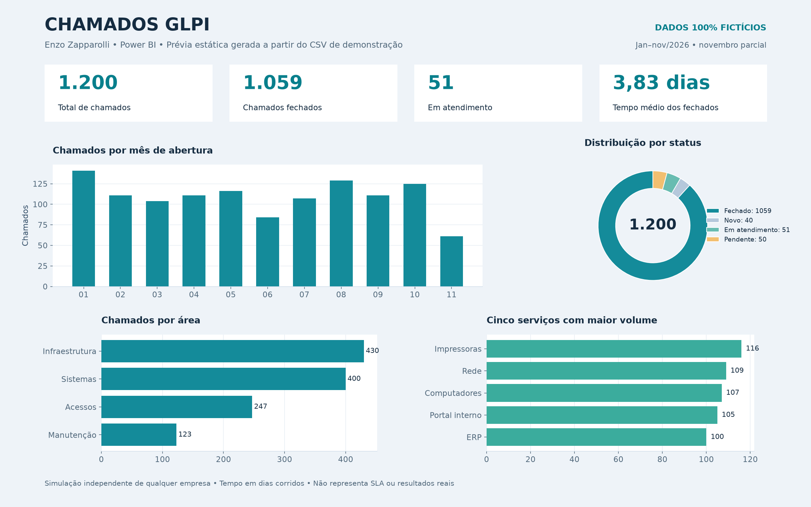

# Dashboard GLPI — acompanhamento de chamados

**Autor do relatório original: Enzo Zapparolli.** Versão demonstrativa adaptada com assistência de IA, com modelo novo e dados 100% sintéticos.

[Portfólio](https://github.com/Enzo-Zapparolli) · [Medidas DAX](medidas.dax) · [Dados fictícios](dados/chamados_sinteticos.csv)

## Objetivo
Facilitar a leitura do volume de chamados, situação dos atendimentos, distribuição por área e serviços mais solicitados. O desenho dos gráficos foi reaproveitado do relatório original; o modelo corporativo e suas fontes não foram copiados para este projeto.

## Abrir
1. Abra `GLPI_Demo.pbip` no Power BI Desktop atualizado. Mantenha as pastas `.Report` e `.SemanticModel` ao lado do arquivo.
2. Clique em **Atualizar / Refresh** para carregar os 1.200 registros sintéticos. A primeira abertura de um PBIP sem cache pode mostrar gráficos vazios até a atualização.
3. A base está embutida no Power Query, sem conexão com sistema corporativo e sem depender de caminhos locais. Uma cópia legível está em `dados/chamados_sinteticos.csv`.
4. Para compartilhar um arquivo único, use **Salvar como** e selecione PBIX, com um nome novo.

## Indicadores e regras
- **Total Chamados:** contagem de linhas da base.
- **Chamados Fechados:** status exatamente `Fechado`.
- **Chamados em Atendimento:** status exatamente `Em atendimento`; não inclui `Novo` e `Pendente`.
- **Tempo Médio Atendimento (dias):** média do tempo corrido entre abertura e fechamento dos chamados fechados. Não representa horas úteis, tempo de primeira resposta ou cumprimento de SLA.
- Evolução mensal usa o mês de abertura no formato `AAAA-MM`.
- Top 5 classifica serviços pelo volume de chamados no contexto do visual.

## Base demonstrativa
Referência: 16/11/2026. Os registros representam aberturas entre janeiro e novembro de 2026; novembro é parcial. Nomes de áreas, serviços e equipes são genéricos. Não há solicitantes, e-mails, descrições reais, credenciais ou conexão GLPI.

O arquivo `dados/resumo_validacao.json` contém os totais de conferência. As expressões DAX usadas no modelo estão em `medidas.dax`. Foram criadas para esta demonstração, sem assumir que reproduzem exatamente as fórmulas do modelo original.

## Competências demonstradas
Power BI, Power Query, DAX, definição de indicadores, organização de dados e comunicação visual aplicada a suporte e operações.

## Validação realizada
O projeto foi aberto no Power BI Desktop e a atualização da base sintética carregou os gráficos. As referências de colunas e medidas do relatório foram conferidas contra o novo modelo. A imagem `previa_dashboard.png` é uma prévia estática produzida a partir do CSV, com estilo próprio; não é captura nem exportação do Power BI.

## Documentação técnica
Estrutura PBIP baseada na documentação oficial da Microsoft:
- https://learn.microsoft.com/en-us/power-bi/developer/projects/projects-overview
- https://learn.microsoft.com/en-us/power-bi/developer/projects/projects-report
- https://learn.microsoft.com/en-us/power-bi/developer/projects/projects-dataset
